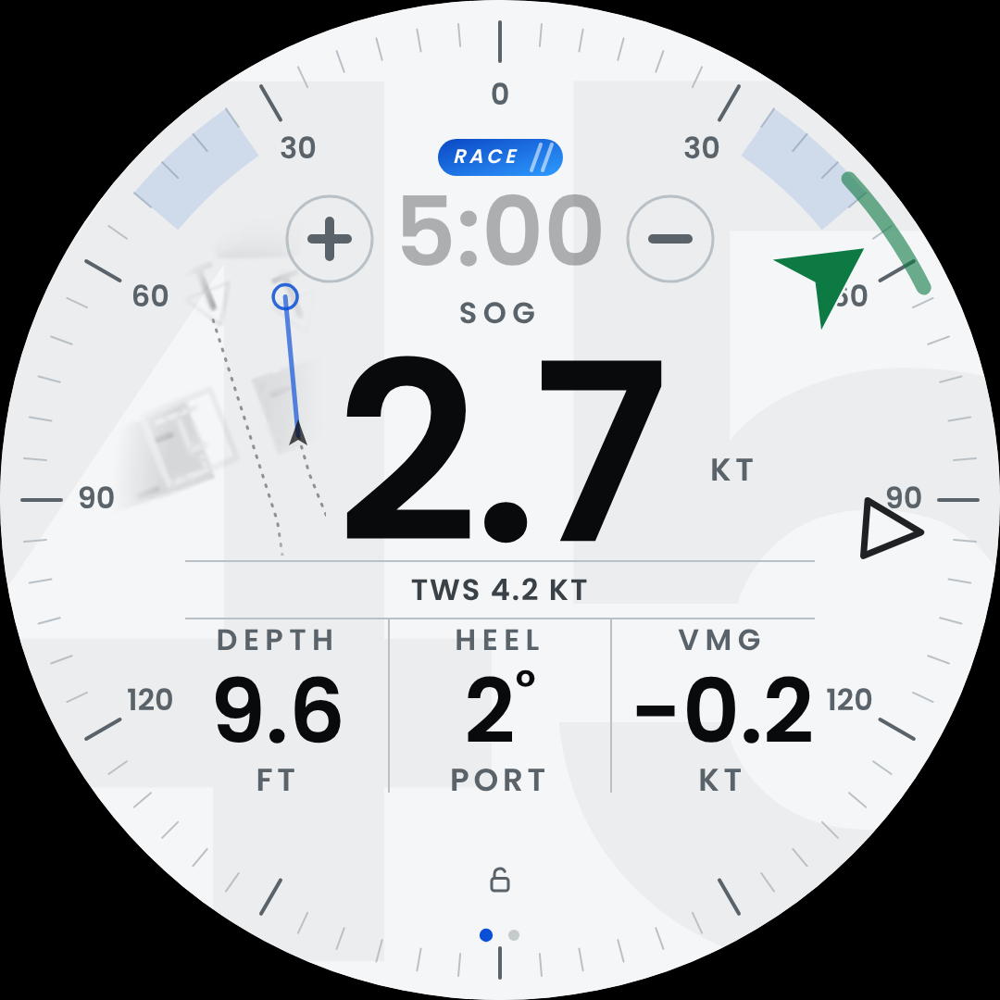
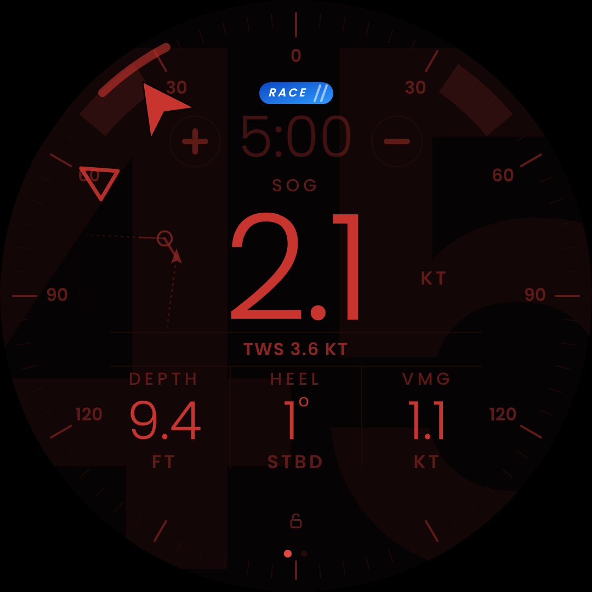

# The route chart

A faint chart with the route you are sailing, in the left of the dial.

[← back to the README](../README.md)



## What it is

When a route is active in Signal K, the empty sector of the dial between
the bezel's 60–120 and the SOG digits shows the corner of a chart, the
way a car shows a corner of the map beside its speed. It is heading-up
and the boat sits low and right in it, just clear of the digits, so the
leg ahead runs up and away into the fade.

It draws, and that is all it does:

- the depth under the route: shallow water darkest, deep water clear,
  land a low flat tone, the 3 ft and 6 ft contours as thin lines, and
  piles and obstructions as small dots — all in the theme's one ink (red
  at night, like everything else)
- the leg behind you, dotted, and the rest of the route ahead, fainter
- the active leg, from the boat to the next waypoint, and a ring on it
- near a turn, a short stub of the next leg, so you can see which way it
  goes
- the boat

There is **no text on it at all** — no waypoint name, no distance, no
turn. The dial already has readings, and a name or a number in this
corner is one more thing to tell apart from them at a glance. The chart
is a picture of where you are going, not a reading. Even the NOAA chart
under it is fetched with its words turned off: no place names, no light
descriptions, no soundings, and the depth contours are drawn without
their numbers.

It is deliberately quiet. The chart image is at .50 by day, .46 at dusk
and .58 at night. The marks run stronger than that, but each is drawn in
a colour no brighter than the dimmest reading on the dial — the TWS
strip, in `--ink-dim` — and short of full strength, so even a mark lying
on chart ink loses to every reading on the glass. That is why the boat
is `--ink-dim` rather than `--ink` (it is a solid shape, and at dusk full
ink was brighter than the strip), and why at night the route is
`--ink-dim` rather than the accent red (night's accent is the brightest
red in the palette). The probe measures the ring and the boat against
the strip off the glass in all three themes. With no route the dial is
exactly the dial it was — the probe checks that pixel for pixel.

The chart fades out before the clock's + at the top and is gone by the
TWS rule at the bottom, so nothing of it reaches the rule or the strip
under it.

The scale follows the next waypoint: it sits about 150 px from the boat
on a leg, and is brought in to 120 near a turn so the next leg, which
after a right turn heads up and right, stays clear of the clock's +. A
waypoint more than a few miles off is past the edge, and the leg simply
runs out into the fade.

Heading-up puts a waypoint off the starboard bow to the right of the
boat, and the boat stands only 30 px from the digits. So when the ring
would not be whole there — cut by the digits' side of the sector, or by
the clock's + — the boat steps left until it is, and for a mark abeam or
astern the scale comes in as well. A leg that does run towards the
digits (the rest of the route, say) ends in a short fade, the way the
chart under it does, never a hard edge. All of this moves with the
digits' own measured edge, in the very frame a speed grows from 9.9 to
10.0.

Where a wind mark comes round onto the left of the bezel the chart gives
way under it — a soft hole that follows the mark — so the wind is never
read through a chart. The hole is there only while it actually reaches
the chart, and moves in whole degrees: moving it re-rasters the whole
chart, so a mark close-hauled or broad on port, above or below the
chart, costs nothing.



### What it is not

It has nothing to do with the race course. The marks, the start line
and the course page are the panel's own, and they never appear here; a
route here is never a course there. Two features that happen to both
have waypoints.

It is not a chart plotter either. Freeboard-SK is the chart plotter;
this is the glance at it you can take from the helm.

## Where the route comes from

**Freeboard-SK.** Plan a route, then *Activate* it (or *Go to* a
waypoint). Freeboard does that through Signal K's **course API**, and the
server publishes the result as deltas, which the panel subscribes to on
the socket it already has open:

| path | what it carries |
|---|---|
| `navigation.course.activeRoute` | the route's `href`, `pointIndex`, `reverse` |
| `navigation.course.nextPoint` | the point being steered for |
| `navigation.course.previousPoint` | where the leg started |
| `navigation.courseGreatCircle.activeRoute.href`, `.nextPoint.position`, `.previousPoint.position` | the same, on the old v1 paths, for a server older than the v2 API |

(These are read off `emitCourseInfo` in signalk-server's
`src/api/course`, not remembered.) They are subscribed `instant` with
**no `minPeriod`**. The server applies `minPeriod` as a debounce that
passes the first value and drops the rest of the window — it does not
send the last one late — and the course API often sends two course
deltas back to back (activating a route over a plotter's course clears
the old one first). With a `minPeriod` the panel kept the clear and
showed nothing while a route was active. On every connect the panel also asks
`GET /signalk/v2/api/vessels/self/navigation/course` once, so a route
activated before the panel came up is there straight away.

The route's **shape** is not in the deltas — only which point is next.
The panel fetches it from
`/signalk/v2/api/resources/routes/<id>` (a GeoJSON LineString), and
again each time the course API re-sends `activeRoute`. That is how an
edit reaches the panel: when the active route is changed in Freeboard
the server re-reads it and re-emits the course with the same `href`,
and that delta is the only word of it the panel gets. Those deltas only
come with a course command or an edit, so it is a request per command,
and the old shape stays drawn until the new one is in. This
means the server needs a **resources provider** for routes: the built-in
*Resources Provider* plugin, enabled in *Server → Plugin Config*.
Freeboard-SK can't save a route without it either, so if you can plan
one you already have it.

The server's own rule for a reversed route is followed: the index counts
along the order the boat sails, so on a reversed route point 0 is the
route's last point. On the first leg the leg starts where the boat was
when the route was activated, not at a point of the route.

A **go-to waypoint** has no route behind it, so it draws one leg.

If anything is missing it is not an error:

- no active route, no fix → no chart, and the dial is untouched
- the route resource 404s (no resources plugin, the route deleted) → the
  leg the course API says you are steering still draws; the rest of the
  route doesn't. It is asked again after a minute, not every second.
- a server without the v2 API → the v1 paths are used, with the next
  point found on the route by position

## The one Signal K setting

The panel is served by `netd` on `:8090` and Signal K is on `:3000`, so
the two GETs above are cross-origin. Signal K's default answers that:
with **Allowed CORS origins** (*Security → Settings*) left empty, the
server replies to every origin. The panel sends no cookie with these
requests, which is both what lets that reply count and what keeps a
stale admin login out of it — with `allow_readonly` on, an anonymous
GET reads; a request carrying an expired login is refused (see
`skHeal` in the page).

**If you have filled in Allowed CORS origins**, add the panel's own
origins to it, or set it to `*`:

```
http://localhost:8090, http://<boat's address>:8090
```

— the first for the kiosk, the second for phones and laptops on the
boat's WiFi. Without that the deltas still arrive over the socket, so
the active leg still draws; only the rest of the route is missing.

Nothing is proxied through `netd` for this, on purpose: its page server
is read-only, and a CORS setting is the server's own business.

## The chart under the route

The chart is drawn from two sources, both fetched by the page itself and
kept on the panel so they work offline after one visit with a signal.

**The coast, the marks and a coarse depth: NOAA's ENC service** (the
electronic navigational charts, rendered by their Maritime Chart
Service):

```
https://gis.charttools.noaa.gov/arcgis/rest/services/MCS/ENCOnline/MapServer/exts/MaritimeChartService/MapServer/export
```

One 1024 px image is fetched around the boat at a power-of-two scale and
moved under the route as the boat sails. A new one is fetched only when
the boat nears the edge of what it covers, or the scale has changed by a
whole level; until it arrives the old one stays up. It is asked for in
the day palette with the depth areas shaded at 1.0, 1.8 and 3.0 m, the
display base and standard categories (so piles and beacons are there),
soundings and every text group off, and **IntendedUsage 4** — without
that, the two coarsest scales (used when the next waypoint is a couple
of kilometres off) came back as one flat land with no lake in it. An
export with nothing to draw in it — no water, and no surveyed lake
either (one flat land, say) — is refused and never cached; one that is
a single depth area from edge to edge (the middle of a big lake) is
water, and is kept. Pixels outside every ENC cell come back transparent
and stay clear unless FWC's survey closes round them (below). US
waters only — elsewhere the route draws on clean glass.

**The depth: Florida Fish and Wildlife's lake bathymetry** — FWC's
*Bathymetry of Select Lakes in Florida*, 1 ft depth contours:

```
https://gis.myfwc.com/hosting/rest/services/Open_Data/Bathymetry_of_Select_Lakes_in_Florida/MapServer/3
```

On Lake Monroe that is the 1 to 20 ft contours, where the ENC has only
its one 6 ft line. The panel asks for the contours in fixed squares of
about 29 km (32768 mercator metres), simplified by the server to about
2 m, a page of 1000 lines at a time until the server stops saying there
are more — some 350 KB for Lake Monroe. A square is kept only when
every one of its pages has come; one cut off part way is not kept as
if it were the whole. Nothing is asked outside Florida.

The chart never waits on FWC to be shown. It is baked first with what
survey is already on the panel, and the squares that are not are then
asked for all at once, under one 45 s deadline, in the background; the
image is baked again when every one has answered. So a hotspot with no
backhaul, where requests hang rather than fail, leaves the kept chart
on the glass at once and the chart loader free for the next image.
Where FWC has no survey (an empty answer), or cannot be reached and has
never been, the ENC's own depth areas are used instead, and FWC is
asked again a minute later, not every second.

Any lake in the survey works the same way — including the many inland
lakes no ENC cell covers (Lake Tohopekaliga and the rest of the
Kissimmee chain): there NOAA's export is transparent from edge to edge,
the survey is waited for (there being nothing else to show), and the
survey alone is the chart, with a rim of the land tone round its
shallowest ring.

**FWC's data is not for navigation.** Its metadata says the survey is
for environmental management and not for navigation. It is
used here knowingly, as a picture of where the shallows are, and it can
be out of date or wrong. The ENC's hazards (piles, obstructions, wrecks)
are always drawn from NOAA, survey or not. Steer by the chart plotter
and the depth sounder, not by this.

### How depth is drawn

Once per image — never per frame — NOAA's picture and FWC's contours
are baked into one alpha per pixel (`chtDepthBake`), and the theme's
ink is painted through it:

| | ink before strength |
|---|---|
| 0–3 ft (and drying ground) | .74 |
| 3–6 ft | .48 |
| 6–10 ft | .26 |
| deeper than 10 ft | clear |
| land | .16, flat |
| the coast | a thin clear gap between land and water |
| the 3 ft and 6 ft contours | full ink, 1 px, with a clear pixel on the deep side |
| piles, obstructions, wrecks, dangers | a 3 px dot of full ink |

Flat washes, no hatching. The strength on top is `--cht-map`: .50 by
day, .46 at dusk, .58 at night. The steps are even on purpose: at night,
the dimmest, every water tone and the contour line sit 25 levels of red
or more from the next, so the 6–10 ft wash — most of Lake Monroe — is
still there in the middle of the lake and not lost in the dial's soft
inboard fade, and a 3 ft line is a line of ink beside the 0–3 ft band
rather than just its clear pixel (which would read the same as the
coast's gap). Land sits under the 6–10 ft wash, a low tone of its own;
it is told from deep water by the coast's clear gap beside it. The
clear pixel beside each contour makes the real boundary a hard edge,
so it is never mistaken for the dial's own soft fades at the edge of
the sector.

Every pixel FWC surveyed takes the depth of its nearest contour — it is
a 1 ft survey, so that is its depth to the foot. On a contour that is a
band's own edge (3, 6, 10 ft) the line cuts its zone in two and each
side takes the side of what it borders: water beside the 7 ft zone is
deeper than 6, beside the 5 ft zone shallower. (Not the nearest other
contour: on a flat bottom the 5 ft line can be nearer than the 7 from
the deep side of the 6.) Which pixels are the survey's at all: in
charted water, those its contours reach through charted water alone,
within 600 m — the whole of a surveyed lake, but never water across the
land from it (another lake, a river), a river more than 600 m past its
mouth, or the rest of a lake whose square of the survey has not come.
On ground no ENC cell covers, only what the contours close round: the
lake inside its shallowest ring, less its islands. Without a survey the
ENC's areas give the bands, coarser: under 1.8 m is the 3–6 ft band,
1.8–3 m the 6–10 ft band, its 1.8 m line the contour.

The marks are read off the export's pure black: a compact black shape
of a few pixels or more, standing in water and not one of a run of
them, is a pile, beacon, obstruction or wreck, and becomes the dot. The
service anti-aliases the coast and symbol outlines, and at the finer
scales the pure black left of them breaks into specks along the line;
those are coast, not hazards. A black symbol on land (a landmark, a
tank) is land. The marsh's grey ring symbols are taken out, so a marsh
is not a row of clear holes.

**Offline.** Every image is kept in IndexedDB, in the same `tilecache`
store the Tracks map uses, under keys of its own (`cht2/<level>/<x>/<y>`)
and under the same oldest-first trim; every FWC square is kept beside
them (`fwc1/<x>/<y>`, compact JSON, an empty square too). So a lake you
have looked at once with a signal has its depth chart every time after
without one. Offline and never been here, it looks for a coarser
picture of the same water it has kept; failing that the route draws on
clean glass, and the dead network is not asked again for a minute. A
kept image that no longer decodes (a blob lost to a power cut on the SD
card) is deleted and fetched again, rather than tried every second for
good, and so is a kept survey square that will not parse. Images kept
under the old `cht/` keys were fetched with the old
display parameters; they are never read, and are deleted the first time
the chart loads — those, and nothing under `cht2/` or `fwc1/`.

### What it costs the Pi

- **Nothing while the dial is covered.** The chart is driven from the
  dial's own draw step, which does not run while a drawer, an app or
  the screensaver is up.
- **One check a second** with no route.
- **At most one repaint a second** with one, and only when the picture
  would move — a boat at rest at the dock repaints nothing.
- **No filter.** The depth chart is baked once per image, with the
  strength painted into its alpha, and only recoloured on a theme
  change. Each repaint after that is a transform.
- **The bake is off the dial's thread.** It runs in a Worker made for
  the one bake and ended after it, about 150–300 ms on a desktop (so
  one to two seconds on a Pi 4) for a 1024 px image, once per area —
  twice when the survey arrives after the image. The images are kept
  at 1024 px. What it holds while it works: the decoded export and a
  canvas of the same size (4 MB each), the export's pixels read back
  (4 MB, and a 4 MB copy into the worker), a distance field (4 MB), a
  work list for its floods (4 MB), and eight one-byte grids (classes,
  contours, nearest depth, side, the survey's reach, outside the
  survey, a visited mark, and the alpha it hands back: 1 MB each) —
  about 32 MB at the peak, all but the canvas and the alpha gone when
  the worker ends. No raster is ever larger than the 1024 px export. Kept after it:
  the canvas (4 MB), the alpha (1 MB), the recoloured PNG and the
  browser's decoded copy of it under the `<image>` (4 MB), the export
  itself while a square of the survey is still to come (some 100 KB),
  and the survey of at most eight squares in memory.
- **A small box.** Everything the chart paints is clipped to the sector,
  so the SOG digits redrawing twenty times a second just to the right
  of it never make it repaint.

## The demo

Turn on the **DEMO** pill and, with no route activated, the demo sail
gets a route of its own - a waypoint every fifteen minutes of the sail -
so the chart can be seen at the dock or on a laptop with no Signal K.
It needs the demo to be playing the boat's position: with a real GPS
fix there is a real boat, and no made-up route is drawn on it. A route
activated in Freeboard-SK always wins over the demo's. DEMO off, and
it is gone.

## Tests

`tests/chart.mjs` — no route is pixel-identical to the dial with the
chart's markup taken out altogether (day, dusk, night), and after a
route has come and gone the chart's half of the dial is the same pixels
again (Chromium re-rasters the far edge of the hull-number watermark a
few levels differently once a chart has been up — nothing of the
chart's); no text in it; the course API's index
and direction, v2 and v1, go-to, a 404 and a server without the API;
an edit to the active route redrawn without a reconnect; the course
paths subscribed with no `minPeriod`; a waypoint to starboard, abeam
and astern keeping its ring whole; the ring and the boat weaker than
the TWS strip in every theme, off the glass; the chart gone by the TWS
rule; the deltas arriving over a real socket; the wind holes, and none
where they would not reach the chart; wide speeds measured off the
glass, and the first frame that shows 10.0; the night ink and strength,
and a theme change in the middle of a bake; the offline cache, and a
cached image that will not decode; and nothing done while the dial is
covered. The depth: FWC's survey (synthetic contours, never FWC's own
data) paged, kept and asked once per square, then baked from the store
offline; a pixel between the 3 and 6 ft contours in the 3–6 ft band and
every band between its own contours, read from all four sides and the
diagonals, with the lines and their clear pixel in order; the tones'
spacing at night; no survey, or FWC unreachable, falls back to the
ENC's bands and is asked again only a minute later; a later page that
fails or errors keeps nothing of its square; FWC hanging leaves the
kept chart on the glass at once and every square asked together; a
kept survey square that will not parse refetched once; images under
the old `cht/` keys never read, and the sweep of them leaving `cht2/`
and `fwc1/` alone; an export with nothing to draw refused and never
cached, one flat depth area kept, and a lake with no ENC cell charted
from the survey alone; transparent pixels clear, a kilometre from a
ring included; a river across the land from a survey left to the ENC;
specks of black along a coast, a dotted outline and a symbol on land
not taken for hazards; a pile a small dot; and not one bake while the
boat is at rest.
