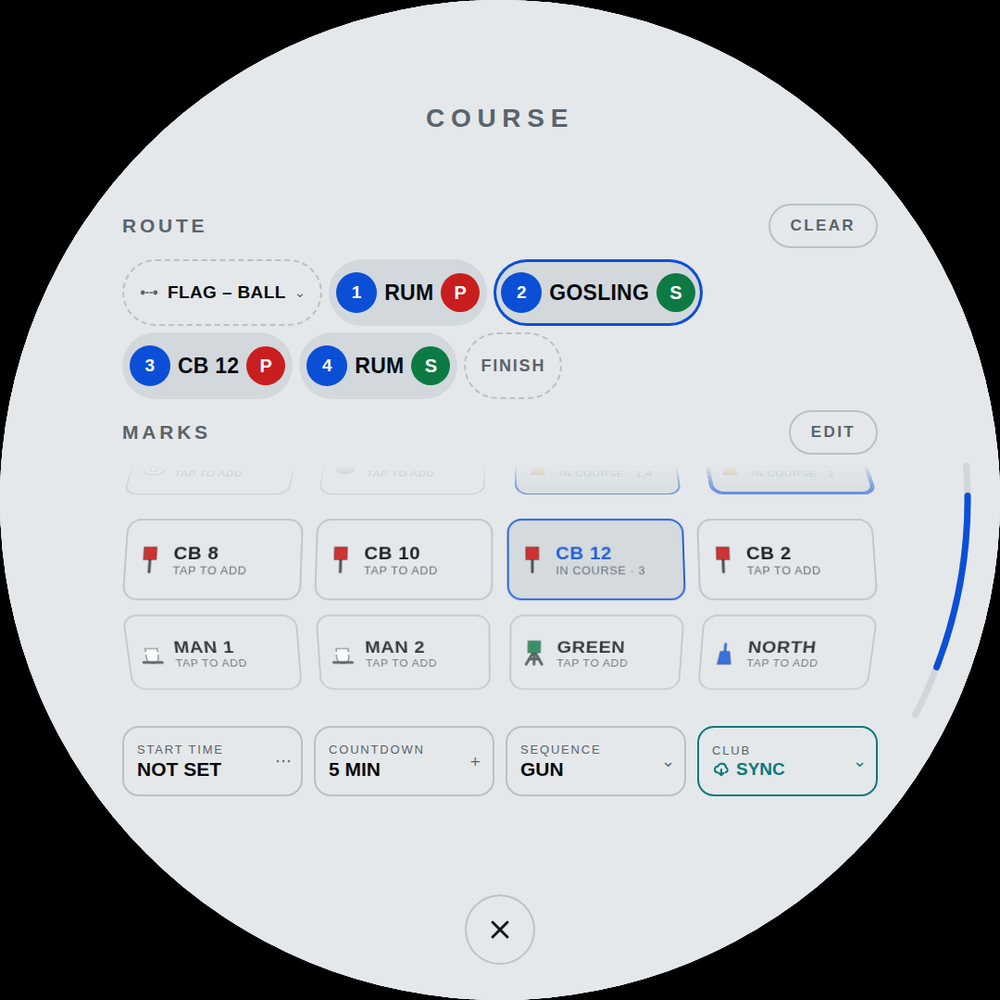

# The display

The three pages, the gestures that move between them, and everything that changes how the glass looks.

[← back to the README](../README.md)

## The hull number

The **45** behind the dial is the hull number, set at 1320 px and 3% ink
so the circle crops both digits — cropped on purpose. It is texture, not
a label: nobody reads it, and you would notice its absence. The ink
follows the theme, .032 by day and .07 at night, because 3% of white on
black is a brighter thing than 3% of black on white.

Two decisions in it are not obvious.

**The 5 sits 14 px lower than the 4.** In Poppins the 5's top bar is
drawn 14 px above the flat top of the 4's stem at this size — 1.06% of
the em, and the same 14 px at weight 500, 600 and 700, so it is the face
itself and not a synthetic bold. Both tops are flat, so there is nothing
optical about it; they simply are not level. With the circle cropping
everything above them, those 14 px are the first thing the eye lands on,
so the 5 comes down 14 and the two tops line up exactly:

| drop | top of the 4 | top of the 5 | |
|---|---|---|---|
| 0 | 88 | 74 | the 5 stands 14 px proud |
| 10 | 88 | 84 | |
| **14** | **88** | **88** | level |
| 18 | 88 | 92 | |
| 26 | 88 | 100 | 12 px past it |

Measured off the rendered glass. **Do not take the number from
`measureText`** — it reports an `actualBoundingBoxAscent` of 969.4 for
both digits, which is flatly contradicted by the pixels, and is how this
was first set to 26 and overshot.

**The run is centred on 488, not on 540.** Two corrections, both of them
leftward:

| | |
|---|---|
| `letter-spacing:-.06em` | lands after the LAST glyph too, so an anchor centred on the advance width sits `(1320 × .06)/2` = 44 px right of where the ink's own centre is |
| the 5 outweighs the 4 | more visual mass on the right, so the perceived centre is right of the geometric one again — a further 12 px |

### Why the split is measured and not written down

Dropping the 5 means splitting one centred run into two `<tspan>`s, and
two tspans do not accumulate letter-spacing the way two glyphs in one run
do: a split that kept `text-anchor="middle"` came out **221 px wider and
17 px left** of the run it replaced. So the anchor is out of it, and each
digit is pinned at the pen position the centred run gave it.

Those pen positions move with the face. The 4's pen lands at **−294 in
Poppins and −167 in DejaVu** — 127 px apart, a tenth of the glass. Write
either number into the markup and the watermark is right on the panel and
wrong in any browser that has to fall back, which at 3% opacity is the
kind of wrong you find a season later.

So the markup carries the centred run, and `markSplit()` measures it and
pins it at boot:

```js
a=t.getStartPositionOfChar(0).x; b=t.getStartPositionOfChar(1).x;
t.removeAttribute('x'); t.removeAttribute('text-anchor');
t.innerHTML='<tspan x="'+a.toFixed(2)+'">4</tspan>'
           +'<tspan x="'+b.toFixed(2)+'" dy="'+MARK_DY+'">5</tspan>';
```

`getStartPositionOfChar`, **not** `getBBox`. The bbox `x` is where the
ink begins, which is inside the advance; pinning the pen there moves the
glyph by its left side bearing, and the rendered diff of that mistake
came to 230,000 px.

The probe in `tests/smoke.mjs` puts the centred run back, asks it where
it draws and compares — so it holds on whatever face is installed — then
checks that the markup itself still has no pen position in it. The first
version of that probe measured a **clone** with the `id` stripped, which
loses `#mark`'s font-size and lays out at a 16 px default: it compared
1320 px positions against 479,488 and could not have agreed with
anything.

## The sensor row

Four glyphs - GPS, depth, wind, heading - green when that source is
feeding, dim when it is not. They live at the top of the **control
panel** rather than on the dial: the face's foot was the one place the
lock and the page dots both needed, and "is anything actually feeding
me" is a question you ask when you are already in the settings.

Their liveness is evaluated in DATA rather than DRAW. Left where it was,
inside the dial's draw gate, the glyphs would freeze whenever the control
panel was open - which is now the only time you can see them.

**The row is just the glyphs now.** It used to carry a pill at each end -
`PHONE` on the left and `DEMO` on the right, absolutely placed so the four
glyphs stayed centred and the pills took slack that was already there.
That was the right shape while there were two of them and the glyphs were
what they were admitting to: both feeds write into the same store the
real sensors do, so while either was on those glyphs were lit green by
numbers nobody measured, and a pill beside them was the only thing on the
panel that said so.

`PHONE` has gone, and one pill pinned to one end of a centred row is not a
layout, it is a leftover. `DEMO` is at the foot of the panel now, under
the build line, centred - which is where a bench control belongs on an
instrument that is not on a bench any more.

## Pages

> **This section described three pages and now there are two.** The track
> map became an app in the dock; the code is the record — `PAGE_MIN=1`,
> `PAGE_MAX=2`, and `#dots` holds two marks. The reasoning below still
> stands for the two that remain, and for why a page is not an app: a
> page is always loaded and always costing something, which is exactly
> why the map stopped being one. The original text is kept as written.

Two places rather than two overlays: the dial and the music panel sit
side by side, and swiping left or right moves along the row. Two dots at
the foot of the screen say where you are. The dial is the one you come
back to.

```
        DIAL   <->   music
       * .            . *
```

The control panel is still an overlay, pulled down from the top over
whatever page you are on - and reachable from any of them, the way
control centre is on a phone. It is a layer over a place, not a place.
While it is up it owns the gestures: left and right do nothing until you
swipe it away.

**Over a running app too.** A pull from the top edge — the top 17% of
the glass, 184 px of 1080, which on every app is above its first row of
anything — brings the panel down over the radar, the tracks app or
golden hour without closing any of them. Brightness, the sounder, the
radios and the theme are not things you should have to leave the radar
to reach. That needs three things to line up: the panel sits at z29,
over a launched app at 25 (and shares 29 with the scroll arc, which is
later in the document, so the panel's own sheet can still show its arc);
the judge asks the panel *before* the app, or a panel pulled down over
one could never be swiped away; and the radar's chart, which fills the
glass and claims every touch on it, lets a touch starting in that band
go unclaimed.

**A swipe no longer closes an app.** A down-flick used to, which is both
why the pull did not work and the wrong control for the job — a flick
that shuts the page you are reading, thrown by the same thumb that
scrolls it. The cross at the foot closes an app now, and only the
cross.

### The race reach

Tracks is the one app you want *during* a race rather than after it, and
a start sequence is the worst moment to go hunting through the dock:
three fingers up, find a tile among four, and your eyes are off the line
for all of it. So while a countdown or a race is running — `raceOn()`,
the same predicate the signals and the line calls use — Tracks is one
swipe off the dial, open and full size, and one swipe back.

```
      [tracks]  <->   DIAL   <->   music       while a race is running
         .             * .          . *        (three dots now - the first
                                                is the reach's, and it is
                                                not a page: see below)
```

**It is a page in reach, not a page in `PAGE_EL`.** Tracks is an app with
a lifecycle — it allocates a map, tiles and a path of up to 800 segments,
and gives all of it back in `tracksClose`. A page is a thing that merely
slides, always loaded and always costing something, which is the whole
reason the map stopped being page 0 in the first place. Making it both
would mean either an app that never frees any of that or a page that
does. The gesture is the only part of being a page that anybody wanted,
so the gesture is the only part it got.

**The direction follows the carousel, not the fingers.** The dial is what
you come back to, so Tracks sits to the *left* of it and is reached
exactly the way page 1 is reached from page 2: fingers travelling right,
which is `right` in the judge. Fingers left comes back — and so does
fingers right, for the reason below.

That choice is what keeps the music page. Three fingers left still pages
to music mid-race, because the reach took the gesture that did *nothing* —
on the dial, `goPage(0)` clamps to 1 — rather than the one that paged. The
reach is asked ahead of `goPage` for the same reason it is safe to ask it
there: it only ever fires on `PAGE_MIN`, where `goPage` had nothing to do
with that swipe anyway. From the music page, three fingers right is still
just the way back to the dial.

**The exception to "only the cross".** A swipe does close an app here,
which the section above says nothing does. The narrowness is the defence:
it is three fingers, not the one that scrolls; only a page you *reached*,
never one you launched; and it takes one step out the same way the cross
does, so the library closes before the app does and a swipe can never
shut Tracks out from under a race you were reading.

**Either direction goes back.** There is nothing to the left of Tracks to
page to, so a swipe that way meaning *nothing* was only ever a chance to
get it wrong with cold hands. Three fingers in either direction returns to
the dial.

### REACHED: the same app, two manners

The difference between a page and an app is one flag, and everything keys
off it.

| | from the dock | reached from the dial |
|---|---|---|
| arrives | appears | slides in from the left |
| the map | pans and pinches under your fingers | a picture that follows the boat |
| leaves by | the cross | three fingers, either way, or the cross |

Launched from the dock, Tracks is an app: a dock is a menu and what it
launches is a thing in front of you. Reached from the dial during a race,
it is a page. Same app, same nodes, same `openApp` — `REACHED` decides the
manner.

It is deliberately *not* `raceOn()`. Reaching the page needs a race;
standing on it does not. Keying the manner off the live race state meant a
gun going off while you read a track would freeze the swipe you came in
with and leave the cross as the only way out, which is the kind of thing
that is only ever discovered at the wrong moment.

**The map had to stop claiming.** `#t-svg` `gClaim()`s every touch on it,
and a claimed gesture is never judged. The first version of this handed
the gesture back when a third finger landed — a `gRelease()` paired with
`gClaim()` — and it worked, but the two fingers that arrived first had
already started a pan and a pinch, so the map lurched every time you
swiped off it. Measured, a single probe swipe moved the committed view's
`mx` from `0.5` to `0.5000309944`; felt, it was the map jumping as you
left.

So a reached page claims nothing at all: `if(reachLive()) return;` before
the claim, and the pan, the pinch and the double-tap refit all go quiet
for as long as you are standing on it. The justification is that a manual
pan is something you do *reading a track back*, which is the dock app,
where none of this fires. The cost is that you cannot pinch into the track
mid-race. If that turns out to matter, the knob is to freeze only
multi-finger gestures and accept a shorter lurch.

### The dot is the indicator

Two dots means the dial and the music. Three means Tracks is one swipe
away. The dot appears when a countdown or a race starts and goes when it
ends, so the row never offers a place that is not there — and it animates
in rather than popping, because a dot that was not there a moment ago
should say so.

It is the first `<i>` in `#dots`, because Tracks sits left of the dial,
and it is **not a page**: the page dots are therefore offset by one, which
is the one thing to get wrong here. Getting it wrong lights the reach's
dot for the dial and there is a probe for exactly that.

It never takes `.on`. The app frame is z25 and the dots are z2, so while
Tracks is up the dots are covered anyway; the dot's whole job is saying
"there is one more place to go" from the dial.

`paintDots()` is called from `tick()` rather than from the five places
`tState` changes, because none of those is a page move and all of them
would have to remember. It is a cached comparison, so the class is only
touched when the answer changes.

### Why it slides

`#app-run` is `display:none` until `.on`, and going from `none` to `block`
with a transform change in the same style recalculation is not a
transition — the browser has nothing to animate from, so the frame simply
appeared. That is what made going back feel like a jump cut rather than a
page move.

Two frames fixes it: one to commit the off-screen position, one to start
the move.

```
raceReach()   .slid           frame is at -100%, no transition
  rAF         .slid           the browser accepts that as the start
  rAF         .anim           transition on, .slid off -> it moves
  +500ms                      .anim comes off again
```

`.anim` comes off at the end on purpose. A transform transition left on
permanently would animate the frame every time `fitStage()` ran. Same
duration and same easing as `#svg` and `#music` — `.42s
cubic-bezier(.16,1,.3,1)` — so the three of them read as one row rather
than two mechanisms.

Going back runs it in reverse and *then* calls `closeApp()`, because
`closeApp` empties `#app-body`: tearing the map out from under a slide
would animate an empty rectangle. `reachBusy` holds for the length of the
move and swallows a second swipe, so you cannot start a move on top of
one.

The probes cover all three, and each was checked by breaking it: removing
the map's early return fails the frozen-map assertions, misnumbering the
dots fails the two dot assertions, and collapsing the two frames into one
fails the slide assertions.

### How many fingers

Two answers, because the two gestures are not the same risk.

| Gesture | Fingers |
|---|---|
| Page left/right between the two dials | **three** |
| Control panel down / up | **one** |
| App dock up / down | **one** |
| Dismiss a launched app, the library, the QR sheet | **one** |
| Taps, holds, every button on every page | one, as always |

**Paging takes the whole hand.** Changing which instrument you are
looking at mid-race because a wave put a wrist on the glass is the
failure worth designing against, and one finger is what rain, spray and
a sleeve produce.

**Everything else takes one.** Raising and dismissing the drawers, a
launched app, the race library, the QR sheet: all visibly reversible, so
a stray touch costs a second rather than your instruments. A tap
anywhere off the dock also closes it.

The drawers were **two fingers** for a while, on the theory that a wave
or a sleeve could raise them by accident. Sailed with, it was wrong. The
drawers are what you reach for most, usually with one hand already busy,
and making the commonest gesture on the panel the fiddliest is a worse
trade than the occasional stray open — which is one swipe to undo. The
knob survives the retreat: `CFG.drawerFingers` is 1, and setting it to 2
puts both drawers back to needing two, in both directions.

`FINGERS` clamps `CFG.swipeFingers` — the **paging** count — and
`DRAWERS` clamps `CFG.drawerFingers` the same way, both against what the
touchscreen can actually report, so a panel that tracks fewer touches
has paging rather than none. It also means the control panel can never
become unreachable if the drawers are ever set back to two — which
matters, because that is where the setting that would fix it lives. A
mouse reports zero touch points, so a desktop browser and the windowed
copy fall back to one finger for everything.

Both are source constants, not panel controls — there is no tile for
them, and the clamp means no setting could rescue a one-point panel
anyway. Change them in `CFG` and deploy.

The overlay branches in `judgeGesture()` deliberately use the
finger-count-free `swipeL`/`swipeR` rather than `left`/`right`: an
overlay that took three fingers to close while one opened the panel
would be the odd one out. The drawer branches ask for `DRAWERS`
explicitly, through `drawUp`/`drawDown`, so that a drawer's dismissal
always costs exactly what raising it did — at 1 that is the same as
plain `up`/`down`, which is what ships.

A gesture is every finger down between the first touch and the last
lift, and the direction is the average of their travel: one finger that
slips while the other two hold still is not a swipe, and averaging says
so.

### Stacking

Written down in the CSS rather than left to DOM order, because it bit
once already:

```
1 pages   2 dots   20 control panel   30 screensaver
55 alerts   70 lock   80 hold ring   90 veil   99 fps readout
```

`#qr-sheet` is the exception: `z-index:10` **within the track page**, so
it covers the race library — its sibling, which has no level of its own —
without leaving the page it belongs to.

The veil is the brightness control on a panel with no backlight to
drive, so it sits above everything and dims the lot. It was on `auto`
until the pages and the panel were given levels, at which point it ended
up underneath both and the slider silently stopped doing anything.

`#panel` sits *before* the music and track pages in the document, so with
everything on `auto` those pages painted over it: the control panel
opened behind whichever page you were on - invisible, and holding the
gestures hostage. That could not happen while the panel was reachable
only from the dial. Making it reachable everywhere is what exposed it.

Nothing new is resident. All three layers were always in the DOM, parked
off-screen with a transform; only the transform is now computed from one
index rather than toggled by a class. Layer promotion stays scoped to the
gesture, so the compositor holds no more than it did.

The dots replaced the SWIPE LEFT/RIGHT/DOWN TO CLOSE captions. Those
existed because nothing indicated the relationship between the views; the
dots make it structural, so there is nothing left to spell out.

Two things to know if you touch this:

- `.open` on `#tmap` and `#music` is now **derived state**, kept in step
  with the index by `layoutPages()`. Everything that already asked
  whether the map or the music panel was showing keeps working; do not
  set it by hand.
- `dialVisible()` is now a question about place - `PAGE_I===1` - not
  about what is covering the dial. During a page change the dial can be
  both on screen and moving, which is the expensive combination, so the
  render freeze over `SLIDE_MS` matters more than it used to.

```
phone / laptop  ->  edit  ->  git push
                                 |
Pi (every 5 min):  git pull  ->  deploy.sh  ->  kiosk restarts
```

`autopull.sh` runs from `~/.config/autostart/` and does that loop. It only
acts when the commit actually changed, so an unchanged poll costs nothing
and the display is never restarted for no reason.

It pulls `--ff-only` deliberately: if the Pi's copy has diverged it stops
and logs rather than inventing a merge commit on a machine nobody is
watching. Being offline is treated as normal, not an error — that is the
usual state out on the water.

The kiosk restart works by killing Chromium and letting `start-kiosk.sh`'s
existing restart loop bring it back, which needs no window-manager tooling.
It matches the kiosk instance only, so a desktop-shortcut window is left
alone.

To deploy without the display restarting under you:

```bash
AUTOPULL_RELOAD=0 bash ~/helm/autopull.sh
```

Manual equivalent, any time:

```bash
cd ~/helm && git pull && bash deploy.sh
```

### Which version am I looking at

`deploy.sh` stamps the served copy with the commit it published, and the
panel prints it at the very bottom of the control panel, under the
shallow-alarm section:

```
87b205f
```

A `+` means the repo had uncommitted changes when it was deployed. The
literal `__BUILD__` means the page came from `~/helm` over `file://` and
was never deployed at all.

This exists because the copies drift, and for a long time nothing said so.
Three of them can disagree at once: the repo, the served copy, and
whatever a running Chromium still has in memory. The specific trap is a
`git pull` run by hand - it moves the repo without deploying, and
`autopull` used to compare only commits, so from then on every poll saw
`before == after` and never noticed that what AvNav was serving was a
different vintage. It now asks `deploy.sh --check` each cycle and
republishes on drift, whatever the commits say.

Each Chromium launch also gets a fresh `?v=` - the kiosk loop and the
windowed one the helper starts. Without it Chromium paints the copy it
already has, so a restart shows the old panel for a moment before the
network catches up. The query string does not change the origin, so chart
tiles and the track library in browser storage survive it.

## The phone is gone

This was a chapter. The helm page ran on a phone: served off the boat
WiFi as a second screen at the rail, installed to a home screen so it
opened without the browser around it, and — with `PHONE` and `MOUNT` on
the control panel — feeding its own GPS in as the boat's speed and
course, and its own compass and accelerometer in as heading and heel.

It earned its place while the panel was being built, because it was the
only way to sail with the thing before there was a thing to sail with.
The panel works now and does the bench testing, so the whole of it has
come out: both pills, the geolocation watch, the device-orientation
listeners, `CFG.phoneGps`, the manifest, the apple-touch icon and the
four rendered PNGs, `tests/phone.mjs`, and the lines in `deploy.sh` that
copied the install set to the boat.

**What a phone can still do is unchanged**, because none of it was ever
part of the above:

| | |
|---|---|
| read the QR on the glass | the track you just published, at an address on the boat WiFi |
| fetch a GPX | AvNav serves `~/avnav/data/user/helm/gpx/`, which is where the helper writes it |
| play the music | Bluetooth to the cockpit speakers, with the panel showing what is on |
| join the hotspot | the Pi's access point, which everything aboard is on |
| open the page | it still renders — nothing refuses a phone, there is simply nothing built for one |

**One thing genuinely went with it.** `PHONE` was also the answer to
*the panel is dead and the race is in twenty minutes*: a phone in a
bracket gave you speed, course, the countdown and its signals, the line
and its bias, bearing and distance to every mark, the rounding, the
track and a finish time — most of a race, off an instrument you already
had in your pocket. There is no fallback now. If the panel fails on the
water, the race is sailed on a watch.

The reasoning that survives it is in the touch targets: 110 px keys and
136 px tiles were sized so they were still 44 px on a 430 px phone, and
they are still that size. The phone was the hard case that set the
numbers, and the numbers were right for a cold thumb on a moving boat
anyway.

## Running a race in a sitting

A five minute sequence and a seventy four minute race is most of an
evening, and the parts worth watching — the signals, the gun, the line,
a rounding, the finish and the card — are minutes apart.

The **DEMO pill is the speed**, at the foot of the control panel under
the build line. Four states, one control:

| taps | | |
|---|---|---|
| off | `DEMO` | no arrows |
| 1 | `DEMO ▶` | real time |
| 2 | `DEMO ▶▶` | twice |
| 3 | `DEMO ▶▶▶` | three times |
| 4 | `DEMO` | off again, back to real time |

All three arrows are always drawn and the ones past the speed you are
on are ghosted — a glyph that changed width would shove the word beside
it every tap, and the ghosts are what say a second and a third speed
exist at all. It winds the race clock and the demo boat on **together**:
a boat at 3× against a countdown at 1× would be a different race, not a
faster one. At 3× the whole thing takes half an hour and you can run it
twice.

Everything the race measures reads `rnow()` and not `Date.now()`: the
countdown, the gun, the elapsed time, the instant the line was crossed,
the seconds to burn. Normally they are the same value to the
millisecond.

`rnow()` is **rebased**, not scaled from an epoch — changing the rate
part way through must not move a gun that has already gone. It is
monotonic across a rate change, and it advances one for one with
`Date.now()` at 1×, so a Pi that boots with no network and gets NTP
hours later carries the race with it rather than being left behind.
Time gained at 3× stays gained; nothing compares the two, and a reload
clears it.

Wall-clock things stay on the wall clock: the screensaver's idle timer,
the alert snooze, the page-slide guard, and the track's 1 Hz sampling.
Those are about the panel, not the race.

**It cannot follow you onto the water.** It is not persisted, so a
restart is always real time. And `CFG.windDemo` is *not* what makes it
safe — that flag is `true` by default and set on a real boat too, where
it only fills what nothing else publishes. What the tick actually
watches is whether the demo still owns the **fix**: walk aboard with the
clock wound on, and the first real position from Signal K puts it back
to 1× and drops the pill to one arrow. A race clock at 3× over a boat
that is genuinely moving would hand you a third of the time you
sailed.

### A race nobody sailed does not reach the club

The finish card walks the whole way through on a demo race — the
spinnaker question, the time, the QR — but it will not post. The far
end is the club's own small server, and a time nobody sailed landing on
the board is not something a tap takes back.

What settles it is **where the fix came from**, asked at the finish and
not when you answer the card. Not `CFG.windDemo`: that is `true` by
default and only means "make up whatever nothing else is publishing",
so a real boat with a real vane has it set all season. The demo stamps
what it writes, so `S['pos.lat'].src` is the honest question, and the
answer is recorded at the moment the race ends — by then the demo may
have been switched off, and the race would still not be one that
happened.

## Golden hour

The icon is a half sun on the horizon with its light on the water — half
a disc rather than a whole one, because a sun *on* the horizon is the
subject and a full circle would read as "weather". Five alternatives
were drawn and rejected, three of them for the reason that keeps coming
up at this stroke weight: shapes that crowd, fuse. An arc with the sun
as a dot on it came out a snail; stacked reflection lines came out a
hamburger; longer rays came out a crown.

Where the sun is in the day, drawn rather than listed. The curve is
today's altitude from midnight to midnight, the disc is now, and the
whole glass is washed in the colour the sky is at that altitude — so the
thing you opened it to check is answered before you read a word of it.
Under it: what is happening, what is next and how long, and the four
times a sailor asks for.

**The palette is keyed on altitude, not on the clock.** That is the only
way it is right in December as well as June, and right at 60° north as
well as 28. Stops are the light a sailor names — night, the three
twilights, the horizon, golden, day — and everything between is
interpolated.

### One altitude became six

`sunTimes` had always answered for exactly one: **-0.833°**, the
horizon, which is sunrise and sunset. Golden hour and the three
twilights are the *same calculation* asked for a different altitude, and
an arc of the day also wants where the sun is right now — so the orbit
came out into a core the three of them share rather than a second copy
of maths that is hard to check by eye.

`sunTimes` keeps its exact old answer, and that is asserted rather than
assumed: the test runs the pre-refactor implementation beside the new
one across six latitudes from Orlando to Svalbard, every seventh day of
a year, and requires **0 ms** of difference — including agreeing on the
35 sampled days where the sun never reaches the altitude at all, which
is not a hypothetical once you sail far enough north.

One honest limit it also pins down: the event solver and the altitude
formula are two different approximations of the same orbit and do not
share every simplification, so the altitude at the moment `sunset` says
is about **-1.0°** rather than exactly -0.833. A fifth of a degree near
the horizon is about forty-five seconds. The test asserts that bound
rather than pretending they agree.

### The bug worth remembering

A leftover gradient from an earlier draft mixed a colour out of `sky.b`,
which is an `rgb()` string the moment the altitude falls *between* two
stops — so it parsed as `NaN` and `addColorStop` threw. It therefore
threw **only at the interpolated altitudes**: at noon and at midnight,
where the altitude clamps to a palette stop and the colour is still hex,
everything worked. Which is to say it was broken at golden hour and blue
hour, and nowhere else — the two states the app exists for.

Rendering it at four moments of one day is what found it, and the suite
now walks every altitude from -40 to +60 through both the palette and a
full repaint.

### What it costs

4.4 MB of canvas while open, nothing when shut — `width = height = 0` on
close, and the ticker cleared. CPU is **1.5% open against 2.4% at rest**,
lower than the dial it replaces for the same reason Tracks is: with an
app up the dial stops drawing. The curve is redrawn once a minute; only
the countdown ticks every second, and that is four lines of text.

## A panel and a dock

Swipe **down** for the control panel, **up** for the app dock. Opposite
edges, opposite gestures, each going back the way it came — the panel
used to come up from the bottom, which is where the drawer lives now, and
two surfaces sharing an edge and an animation would have been two things
that felt like one.

An **app is not a page**. A page is always loaded and always costing
something; an app exists between the tap that launches it and the tap
that closes it, and then it is torn down. Each entry in `APPS` carries
its own `open(host)` and `close()`, because only the app knows what it
allocated.

The two are not the same shape, and should not be. The panel takes the
whole glass because it is somewhere you go. The dock is a **dock**: one
row tall, and the dial keeps drawing behind it, because reaching for an
app should not feel like leaving the page.

660 wide with its foot at y=954 puts its lowest corners 529 out — the
same geometry the radar toolbar sits on, and the same 11px of margin
inside the 540 the glass stops at. The row is held to 600 rather than
the dock's full inner width, so its ends cannot reach the rim when a
second app arrives.

### Two cards across

The panel is a **grid**, not a column. Everything it has is on the glass
at once: DISPLAY and SHALLOW ALARM on one row, SOUNDER under them, with
the sensor glyphs and the radios full-width above. A START card sat
beside the sounder until the start time arrived; it is on the course
sheet now, with the rest of the start.

It was a single 600 px column of sections, and it outgrew the circle.
600 px wide on a radius of 540 is only lit between y=91 and y=989 —
about 900 px — and the sheet had reached 1147. What happened then was
not a scrollbar: the panel centres its child, so the sensor row hung off
the top at y=−33 and the build stamp sat eight px past the bottom, with
no way to reach either.

Two columns is 600 px for the same content, which is the round glass
being used where it is widest instead of wasted.

Both cards in a row take the height of the taller one, and the shorter
one **spreads** into it rather than leaving a lake of empty border under
its content — stretching without spreading was the first pass, and it
read as padding rather than density. The payoff is that the brightness
slider lands on the same centreline as the depth steppers beside it,
which is what makes a row of two read as one row rather than two things
that happen to be adjacent.

The sensor row and the radios keep the **narrow** 600 px column. They
sit at the top of the circle, where 880 px has its ends out in the
black.

START carried a line under its pills spelling out what each one did —
`THE LINE IS SHUT UNTIL ZERO` and so on. It is gone, on the same
reasoning as the paging captions above: the two words say it to anyone
who races, and a panel that explains itself every time you open it is a
panel you stop reading. `docs/readings.md` has the long version. It
also took the last thing in the panel whose height changed as you used
it — the two sentences were different lengths, so tapping the other
pill shoved the right-hand column about.

**It still scrolls** if it ever stops fitting — with the radios expanded
and a section or two added it could. `max-height` rather than `height`,
so a panel that fits is centred exactly as before, and the edges fade
only when there is something under them: on a round panel a hard cut at
a chord just looks like the layout is broken.

### What a box that scrolls looks like

Nothing on the glass shows the browser's own scrollbar. A straight grey
rectangle laid down one side is the one shape here that belongs to
nothing else on a round face, and it is furniture that a 1080 circle has
no room for. Two things stand in for it, and both are shared by every
scroller in the app — the settings sheet, the marks grid on the course
sheet, the race library, and the dock's sideways row of apps.

**The box fades at the edge the content is crossing.** The panel sheet
has done this since it outgrew the glass, for the reason above: a hard
cut at a chord reads as a broken layout, and a row sliced in half reads
as a fault rather than as more list. Only the edge with something behind
it fades — `.over-a` for the leading edge, `.over-z` for the trailing
one, both set by `scrollFit()` off `scrollTop` — because a list sitting
at the top with its first row dimmed reads as a rendering bug. At zero
the gradient's two stops meet and there is no fade at all, which is how
an edge switches off.



**And a track lies on the drum** beside the rows. `#arc` is one SVG
overlay for the whole instrument, drawn in stage coordinates: the track
spans exactly the rows the box is a window onto, and the accent length
inside it is that window. One overlay serves every scroller because only
one thing is ever being scrolled — it simply appears beside whichever
box it is.

It was an arc of the **glass's** rim, struck about the centre of the
circle at 540. A list is hardly ever centred there: the marks grid runs
503 to 772, so it was handed one quadrant of that circle and bent the
whole way in one direction, while the drum beside it bulged about its
own middle at 638. Two centres, two curves, and the eye sees it. It is
built from the same middle as the rows now, symmetric about the list —
and drawn as a filled ribbon rather than a stroked line, because a
stroke cannot change width along its length and the point is that it is
thickest where the drum faces you.

The **amplitude is designed, not derived**, and that is worth writing
down. The rows' own outlines barely taper: each tile is scaled about
*its* centre rather than the grid's, so the rightmost column moves in by
a tenth of a tile instead of a tenth of the grid — and then perspective
magnifies the near edge of a tilted tile by about as much as the scale
shrinks it, so a measured silhouette comes back within a pixel of
straight at every height. A track traced onto that would be a straight
line, which says nothing. So the curve is the drum's, drawn at an
amplitude you can see: 14 px clear of the rows at the ends, 36 at the
middle, with the apex rounded because |u| has a corner at nought and a
drum has no point on it.

It is up for 900 ms after the last scroll event and then fades, and it
flashes once when a sheet opens with more in it than it can show. Up
permanently it would be furniture again; down, the box's own faded edge
is still saying there is more. The right half of the circle is where it
lives, because `Math.asin` lands in −90…90 and that is the side a helm
is not reaching across.

The dock's row scrolls sideways, so its fade runs the other way and it
gets no arc: the rim is a vertical idea.

### The drum

A list that scrolls flat is a window cut in the glass. On a round face
it can be the face itself turning instead, and that is what the marks
grid and the race library do: rows tip away as they reach the top and
the bottom, go smaller and go dim, and the row you are looking at is the
one square on. It is the same shape as the buoy you are looking for out
there — a thing you see part of because the rest of it has gone round.

**It turns whether or not there is anything to scroll.** Curving only
the boxes that overflow made the curve a signal, which was tidy — and it
also meant the marks grid changed shape when an eleventh mark was added,
so the one surface you look at most had two appearances and no say in
which. A drum is what the list *is*, not a thing that happens to it once
it gets long. Saying there is more is the lit track's job and the faded
edge's, and two of those is enough.

`perspective` goes on the scroller, not on each row, so every row is
seen from one place — the middle of the box. That is what makes them
read as one surface rather than as rows that each happen to be tilted,
and it is why the four tiles across a grid row come out at the same
angle.

`drumPaint()` is the whole of it. `u` is how far a row's centre is from
the middle of the box as a fraction of half the box: 0 square on, ±1 at
the edge. Tilt is `−u × 34°`, scale is `1 − |u| × 0.11`, opacity is
`1 − |u| × 0.42`. 38° was too much to read at the edges and 22° was not
a drum at all. It is an approximation of a cylinder rather than the real
thing — there is no `translateZ` putting each row on the actual surface,
because that needs a radius and the radius moves with the box height.
What the eye reads is the tilt and the taper; the missing depth is a
pixel or two at the edges.

One paint per frame however many scroll events land in it, via
`drumTick()` and a single `requestAnimationFrame`.

**It is opt-in, and that was a bug for a while.** `rimWatch()` wires a
box for the fade, the arc and the drum, and the drum used to come with
the wiring. Boxes that were never drawn for it got it anyway — and
without a `perspective` on the scroller a `rotateX` is not a cylinder,
it is a vertical squash. The radio picker was the one that showed: two
clean lines of type per row at rest, and the moment you scrolled they
went short and grey and stayed that way. A surface that changes
appearance under the finger reads as damage, not as motion. The drum is
now asked for by name, and only the marks grid and the race library ask
— the two boxes with the `perspective` rule, and the two that turn all
the time, so nothing about them changes under the finger either.

The cost is real and worth naming: the rows at the edges are dimmed to
about 0.42 and shrunk, which is harder to read in sunlight than a flat
row was. The row you are reaching for is the one square on, which is the
bet the whole idea rests on.

### Scrolling against the gesture judge

The scroller shares its glass with the gesture judge, which is the
awkward part — a swipe up closes the panel, and a swipe up is also how
you scroll down. So it claims the drag **lazily**: on the first movement,
and only as much as it can absorb. At the end of its travel it hands the
gesture back, and the same swipe closes the panel.

### The dead band at the foot of the dial

A swipe up could not *start* at the bottom of the glass, which is
exactly where a thumb reaches to pull the dock. The dial's lock sits at
`translate(540 950)` and `holdBind` used to `stopPropagation()` its
pointerdown — so `#stage` never saw the touch, no gesture was ever
created, and y≈940–990 was dead. Measured: a 220px flick up opened the
dock from every height **except** 950 and 980.

Swallowing was the wrong tool. The touch is **claimed** instead, and the
claim is marked as one that gives way:

```js
if(G.releaseOnDrag && Math.hypot(q.x-q.x0, q.y-q.y0) > 24){
  G.claimed = false; G.releaseOnDrag = false; holdCancel();
}
```

A finger that stays put still holds, and still owns the gesture, so a
hold on the lock cannot also fire the dial's hold-to-reset. A finger
that travels releases the claim and cancels the hold, and the swipe is
judged normally. Opt-in via `releaseOnDrag`, because the claims that are
*not* holds — the radar scrub, the volume ring — drag on purpose and
must keep theirs.

`pointerup` no longer stops propagation either, and never needed to:
`endGesture` listens on window in the **capture** phase, which runs
before any of it.

### Swiping off the bezel

A swipe that begins at the **rim** is not the same gesture as one that
begins in the middle, and asking the same of it is why it never felt
like you could start on the bezel. The thumb is already at the edge of
the glass when it lands, so there is less panel to travel over; it
arrives rolling in off the bezel, so it arrives diagonally; and it is a
deliberate reach rather than a flick, so it is slower.

Outside 78% of the radius, all three get their own allowance:

| | middle | rim |
|---|---|---|
| travel | 70px | **40px** |
| time | 700ms | **900ms** |
| off-axis | must dominate | may lean 25% |

40 is still well clear of the 24px that separates a tap from a drag, so
a touch at the rim does not become a swipe by accident — measured, a
30px movement out there is still a tap, and a 50px one in the middle is
still not a swipe. The dial does not become twitchy to pay for the rim.

Rim or middle is decided from the **average** start point, the same way
the travel is averaged, so a second finger along for the ride does not
move the gesture out of the rim's allowance. Tested both ways, off the
bezel with no `pointerdown` at all (below): one thumb and two fingers
each raise the dock from y=1074.

### touch-action does not inherit

This is the one that actually killed edge swipes on the hardware, and no
headless test could ever have caught it: synthetic `PointerEvent`s never
go near the browser's touch pipeline.

`html, body { touch-action: none }` was set, and it changed **nothing**
for anything inside the stage — the property is not inherited, so every
tick, dial and button computed to `auto`. On a real touchscreen `auto`
hands Chromium the right to decide a touch is a pan of its own and fire
`pointercancel` part way through, which is a swipe that dies silently.
The browser is keenest to claim exactly at the edges.

```css
#stage, #stage * { touch-action: none }
```

The radar canvas and the scrub band already carried their own copy of
this, for exactly that reason. The dial never got one — and the bottom
centre, the major tick you reach for to pull the dock, is where it
showed. Nothing inside the stage scrolls or pinches, so nothing is given
up. What is asserted in the test is the computed property itself, since
the failure it prevents cannot be reproduced.

### A finger that arrives already moving

Coming in over the **bezel**, the contact begins off the glass. The
digitizer first sees it mid-motion, and the `pointerdown` that should
start the gesture is swallowed by the controller's edge rejection — or
never fires at all, because there was nothing to press down on. The page
is given moves and nothing else, and a tracker keyed on `pointerdown`
never learns the finger exists.

So the first **move** seeds the gesture:

```js
if(!q && e.buttons) q = gAdd(e);
```

`buttons`, because a mouse merely hovering across the panel must not
open anything; for touch it is set for as long as there is contact.

That cuts both ways, though. If a gesture can begin without a
`pointerdown`, a contact can also end without a `pointerup` — the rim
does exactly that, the finger simply stops being reported — and
`G.live` would never come back to zero, leaving every later gesture dead
with no way out but a power cycle. That failure has bitten this file
before. So every gesture is now born in one place, `gStart()`, which
discards a wreck older than `GESTURE_MAX` rather than joining it.

Time, not live count: `gClaim` makes a `G` with no fingers in it and the
pointerdown adds one a moment later, so a live-count test would throw
the claim away in between.

The listeners also moved from `#stage` to **window**. `#stage` is
`border-radius:50%`, and a rounded box does not hit-test outside its own
shape — so a touch that landed on the rim, or on the digitizer's report
of it a pixel or two proud of the glass, missed the element entirely and
never became a gesture at all. Window catches everything, and still runs
after the target's own listeners, which is what `gClaim` depends on.

### The dismiss swipe is local

The dock covers a strip at the foot and leaves the dial in plain sight,
so a flick anywhere on that dial should not dismiss a thing sitting
somewhere else. A downward swipe closes it only if it **started** within
`DOCK_REACH` (110px) of the card — measured from where the fingers went
down, averaged the same way their travel is. Generous rather than exact,
because a thumb aiming at a card is not aiming at its border. A tap off
the dock still closes it from anywhere.

A tap anywhere off the dock closes it; a tap on it does not. The
full-height surface is still there for that, just transparent — which is
what a scrim would otherwise be for.

`dialVisible()` deliberately does **not** list the dock. The panel covers
the glass and a running app replaces it, but a dock leaves the dial in
plain sight, and a dial frozen in plain sight reads as a crash.

The `.grab` mark sits on whichever edge the overlay travels from — the
edge your thumb pulls. The panel comes down from the top now, so its
grab belongs at the bottom; it sat at the top for as long as the panel
came up, and stayed there when the gesture was flipped.

## Preferences

Theme, depth units, the shallow alarm and brightness persist in
`localStorage` under `helmPrefs`. They did not before: every kiosk
restart - which is every deploy, every autopull and every crash - put them
silently back to AUTO, feet and 6 ft. An instrument that forgets how you
set it is not one you can trust to be set.

Values are validated on the way in, not trusted. That storage outlives
every version of this app that has ever run on the Pi, and something
merely old must not be able to break the boot: an unknown theme, a depth
of 99999 or a string where a number belongs all fall back to the default.

## Brightness

Two mechanisms, and only one of them is real.

The slider used to paint a black veil over the picture. The backlight
stayed at full behind it, so at night it still lit the cockpit, still drew
the same power, and only made the instruments harder to read. A browser
cannot reach the backlight - but `netd.py` can, where the kernel exposes
one and udev has made it writable.

When it can, the slider drives the real backlight and the veil stays at
zero. When it cannot - which is the case on this boat's panel, where the
kernel exposes no backlight at all and the display has no DDC either -
the veil is all there is.

Worth knowing what that means: compositing black over the image does
reduce emitted light, because the LCD pixels block more of it, so it
genuinely helps at night. What it cannot do is turn the lamp down. Blacks
stay grey, contrast falls as you dim, and the power draw does not change -
so dimming the screen overnight at anchor saves nothing on the battery.

If your panel has a backlight the kernel knows about but the file is
root-only:

```
echo 'SUBSYSTEM=="backlight",RUN+="/bin/chmod 666 /sys/class/backlight/%k/brightness"' \
  | sudo tee /etc/udev/rules.d/99-backlight.rules
```

then reboot. `netd.py` says which it found at startup:

```
[netd] backlight: rpi_backlight at 100%
[netd] backlight: NO - present but not writable
[netd] backlight: NO - none exposed
```

The helper floors it at 5% and never writes zero. A helm you cannot see is
a helm where you cannot find the slider to turn it back up.

### Why there is no display-off option

There was one, briefly: a `DARK` tile beside `SAVER` that put the
display out instead of showing the ambient readings. It came off again,
and the reason is worth keeping.

**A page cannot turn a display off.** All it can do on its own is paint
the pixels black, and on an LCD that saves nothing worth measuring — the
backlight is behind the pixels and stays lit whatever they show. What
*can* is `netd`, when the kernel gives it a `/sys/class/backlight`
device, because the backlight is most of what a panel draws.

The panel this runs on is an HDMI round display, and the kernel exposes
no backlight for it — that class is mostly for DSI and DPI panels wired
to the Pi's own connectors. So the tile read `BLACK ONLY` on the boat,
which is what it was built to say rather than claim a saving it was not
making, and a control whose honest label is "this does nothing for you"
is a control to delete.

**The display's own power button does the real thing.** It cuts the
backlight and the panel's electronics, and the Pi keeps running
underneath — still logging the track, still counting the race clock,
still serving the page. The one thing to check, once, at the dock: an
HDMI display powering off can read as unplugged, and the Pi may come
back at a different resolution. `video=HDMI-A-1:1080x1080@60D` in
`cmdline.txt` holds the mode while the panel is dark.

`netd`'s backlight path stays, because the brightness slider uses it on
any rig that does have one, and it now has `tests/backlight_test.py` —
the first tests it has ever had, which is why they stayed when the thing
that prompted them did not.

## Touch lock

A small padlock in the same place on every page - just above the page
dots, at the foot of the screen. The dial's copy is drawn in the SVG at
the matching y rather than as an HTML button: the face is a 1080 viewBox
over a 1080 stage, so the coordinates line up exactly and it scales with
the dial in windowed mode. **Hold it for two seconds** and the helm locks.
Hold anywhere for two seconds and it unlocks.

Both directions are the same deliberate act, so there is nothing to learn
twice, and both draw the same indicator: a ring sweeping round the whole
bezel. At 1080 across it is unmistakable from the other side of the
cockpit, and it makes an accidental brush obviously not a lock.

Why it exists: spray and rain generate touches on capacitive glass, and a
wave should not be able to change the shallow alarm or drop the hotspot.
Two seconds is the one gesture weather cannot produce.

The overlay swallows every pointer event and paints nothing over the
instruments. **Locked is read-only, not blank** - you still need depth and
speed while the boat is being rained on. It does not survive a reload,
deliberately: being locked out by a crash would be worse than the problem
it solves.

**The overlay is not enough on its own, and for a long time it was all
there was.** A transparent box on top of the page stops anything bound to
an element underneath it, which is every button on the instrument. It
does nothing about the gesture judge, which is bound to `window` in the
capture phase on purpose - a finger arriving over the rim has to be
counted, and a round `#stage` will not hit-test it. The judge therefore
never saw the overlay, and every swipe went straight through a locked
screen: pages turned, the control panel came down, the dock came up, and
a hold anywhere reset the race. `locked()` existed and gated nothing.

`judgeGesture()` returns immediately while locked, which is the one
choke point all of those share, and `goPage`, `openPanel` and `openApps`
each refuse as well - the belt to that pair of braces, for any path into
them added later. The two-second hold that unlocks never reaches the
judge, because a hold control claims the gesture the moment it is
touched.

The icons are state, not instruction, and they follow it: the overlay is
transparent, so all three page buttons stay in plain sight while the helm
is locked, and a shackle still hanging open under a locked screen would
simply be wrong. They close and take the accent colour when locked.

**There is no badge.** A `HOLD TO UNLOCK` card used to appear on every
touch of a locked screen. It was one more thing between you and the
instruments, and it was saying what the shut padlock at the foot of the
page already says. Locked reads as an instrument panel now, not as a
padlock you have to look past.

Everything that binds the hold stops propagation as well as preventing
default. These sit on top of the gesture handler, and without it a hold
that wanders a few pixels reads as a swipe - and a locked screen happily
opens panels behind itself, which is what the first version did.

## Alerts

One surface for anything that needs attention, so the next thing to raise
one - anchor drag, low battery, an adapter that vanished - does not have
to invent its own way of saying so.

```js
alertRaise('depth','alarm','SHALLOW · 15 FT','ALARM SET AT 40 FT');
alertClear('depth');
```

Two levels. `alarm` wakes the screensaver, `warn` does not. The banner
shows the worst unacknowledged alert; tapping snoozes it for ten minutes
while the condition stays live underneath and says so again when the
snooze expires.

The shallow alarm is its first customer, and moving it exposed a real bug:
it used to be a class toggle inside the dial's DRAW gate, so it **did not
run at all while the map or the music panel was open** - precisely when
nobody is watching the number. Alerts are evaluated in DATA, which always
runs, and the banner sits above the panels and the screensaver so it is
visible wherever you are.

Alert text carries whole units rather than tenths on purpose: to a tenth
the banner would rewrite itself several times a second for no added
meaning.

## Sound

The horn and the glass share one box on the control panel. They were two
cards — `TOUCH SOUND` and `SOUNDER` — which is two bordered boxes, two
headings and two thirds of a row of the panel spent on saying *sound*
twice. They are not the same noise, so the box names both down its left
edge: `HORN` is the thing on the coachroof and `TOUCH` is the glass
under your finger. Labels beside the controls rather than headings over
them, because two headings inside one box is the two boxes back again.

**The box is there whatever the boat has.** `TOUCH` applies to every
rig — it comes out of whatever is playing the page, so it works on the
phone, where there is no `netd` to ask — while `HORN` and the output
line under it appear only when `netd` reports a sounder. The old card
hid itself entirely on a boat with none, which was right when it was
only the horn: an empty bordered box would have been worse than the gap.
Half a box has no such problem.

It comes out the same height as `DISPLAY` and `SHALLOW ALARM` beside it,
which is not only tidiness: it sits in the lower left where the glass is
running out, and at 256 tall its bottom corner was three pixels off the
rim. Two rows in a box the others fill with one means tighter rows and
shorter buttons. A probe holds every card to within 4 px of the others.

### What the glass sounds like

A capacitive panel gives nothing back. No travel, no detent: gloved,
wet, or braced against a heel you cannot tell a tap that landed from one
that slid off without looking up to see what changed — and what changed
is often a number two inches from where you were looking. A sound
answers that, and it answers before the screen has repainted.

This is **not** the countdown's buzzer below. That goes out to `netd`
and the horn on the coachroof and is meant for the foredeck; this comes
out of whatever is playing the page, so it works on the phone too, where
there is no `netd` to ask.

**Synthesised, not sampled.** Nine voices at a few hundred bytes of code
keeps a file that still opens over `file://` with nothing beside it,
which is the premise of the whole thing; nine WAVs is a folder to lose.

| | what it is | when it is the right one |
|---|---|---|
| `GLASS` | 2950 Hz with partials at 5210 and 7780, 75 ms | **the default.** A fingernail on the pane. Those ratios — 1.77, 2.64 — are a *plate's* and not a chord's, and that inharmonicity is the difference between a tink and a note. Each partial dies faster than the one below it, as a real pane's high modes do |
| `TICK` | filtered noise at 2.5 kHz over a 3.2 kHz pip, 8 ms, dry | a switch. Disappears into the background; you notice it when it is missing |
| `CRYSTAL` | two sines 4 Hz apart at 2620 Hz, plus 6870, 300 ms | a wine glass struck at the rim. Where `GLASS` is a plate, this is a thin-walled vessel — nearly one mode, ringing a third of a second. The shimmer is the 4 Hz beat: a real glass is never perfectly round, so its two perpendicular modes sit apart and the note pulses. One partial alone is a test tone |
| `PAD` | bandpassed breath at 3.4 kHz over a lowpassed thud, 13 ms | the flat of a finger arriving, which is the sound the panel actually makes when you use it. The quietest of the set on purpose: the tap you made, not a noise about it |
| `FROST` | a bandpass at Q 6 sweeping 1800→3200 Hz over 55 ms, swelling | a finger **dragged** across the pane rather than landing on it. Not a burst decaying but a resonance climbing while it swells, which is stick-slip: skin grabbing and releasing the glass hundreds of times a second. The only one here that is a touch rather than a strike |
| `DROP` | a sine falling 1180→620 Hz over 90 ms, no transient | the least machine-like of them — closest to water |
| `KEY` | a 4 kHz noise transient over a short triangle | the most definite. A typewriter |
| `BELL` | two sine partials at an inharmonic 2.6 ratio, 220 ms | a struck thing rather than a chord. The longest, so a flurry of taps overlaps into something musical |
| `THOCK` | 210→150 Hz under a lowpassed transient, 130 ms | the one that carries over an engine, because it is under the engine rather than over it |

`GLASS` is the default because the panel **is** glass: it is the one
voice that is not a noise the instrument decided to make, but the noise
the thing under your finger would have made anyway.

Plus `OFF`. The panel's control **cycles** rather than listing ten, and
**plays what it lands on** — the only way to choose a sound is to hear
it, so the control that changes it is the control that sounds it.

**Each voice carries its own gain.** Five sounds built to the same peak
are not five sounds of the same loudness: a 6 ms `TICK` and a 130 ms
`THOCK` at equal amplitude are 9.5 dB apart to an ear that integrates
over about a fifth of a second. Equalising that energy outright
overshoots the other way and clips the short ones, so `CLICK_GAIN` is
the square root of it — the usual compromise between peak and loudness
for a transient. The two long ones are levelled by peak instead, and
`CRYSTAL` a shade under that: at 300 ms it is the longest by far, and a
long sound at equal peak is tiring by the hundredth tap. The numbers are measured rather than guessed: the same
synthesis is rendered offline and the 200 ms energy of each read off.

**What makes a noise is listed, not inferred.** A swipe that pages the
dial, a drag across the map and a scroll down the marks all begin with a
`pointerdown`, and a click on each of those is the panel claiming it did
something it has not done. `CLICKABLE` names the controls — half of them
SVG, since the dial's cells and the line's two ping buttons are not
buttons however much they behave like them. The listener is on the
capture phase so nothing downstream can swallow it, and it neither
claims the gesture nor prevents anything, so nothing downstream can tell
it ran.

The power sheet's slide-to-confirm bar is the exception, and is not in
that list at all: its knob is a `div`, nothing on the bar is tappable,
and the drag handler makes the sound itself - once when a thumb takes
hold, and again at the far end when the slide commits. Taking hold and
letting go short of the end is not an action, and does not sound like
one.

The context is made on the first tap and kept. One created before any
gesture starts suspended and browsers resume it only on one — which
every caller here is, so it comes up on the first thing you touch.

One thing to listen for on the Pi: its analogue output powers down while
idle and wakes with a pop, which is why the countdown arms the output
ten seconds before the gun (below). A touch sound after a quiet spell
may carry that same pop. Taps in a flurry keep it awake and are clean.

### What it costs

Measured, per process, with PSS rather than RSS — a Chromium process's
resident set is mostly the binary and the libraries it shares with the
other seven, and counting that once per process answers a question
nobody asked.

| | |
|---|---|
| `OFF` | **nothing.** No context, no process, no buffer. The listener returns before `ac()` is ever reached, so the cost of not wanting this is zero, and a probe asserts it |
| the audio context | **26.5 MB PSS** — a whole extra Chromium process, its Audio Service, spawned on the first tap and kept. This is the entire cost, and none of it is ours: an empty page that makes one `AudioContext` pays exactly the same |
| the noise buffer | 88,200 bytes — half a second at 44.1 kHz, made once and replayed at an offset |
| the JS heap | 189 KB in total, the buffer included |
| 600 further taps | **+4 KB.** The nodes are created per tap and collected after `stop()`; nothing accumulates |

So: about 27 MB while it is on, almost all of it the price of admission
to Web Audio at all, and 0 while it is off. On a 4 GB Pi that is 0.7% of
the machine. It is worth knowing before turning it on, and it is worth
nothing after.

## Countdown signals

The countdown sounds the pattern a race committee sounds, so it needs no
learning by anyone who has raced:

| When | Signal |
|---|---|
| every whole minute | long |
| 30, 20 and 10 seconds | short |
| the last five seconds | short |
| the gun | long, and green |

One schedule feeds both ways of taking it, so the eye and the ear can
never disagree:

```js
sigFor(300) // 'long'   a whole minute
sigFor(10)  // 'short'
sigFor(9)   // null     nothing on the seconds between
sigFor(0)   // 'gun'
```

**The flash** is a full-face colour wash, the accent for the four signals
before the gun and green for the gun itself — the one you act on should
not look like the four that precede it. It lives inside `#stage`, so it
lights the round face and not the letterbox either side, and it sits
above everything on it: a start signal has to arrive whether the control
panel, an app or the screensaver is up. It wakes the screensaver for the
same reason the shallow alarm does.

It snaps on and fades off. An instant edge reads as a signal and an
instant end reads as a fault, which is worth the extra line of CSS.

The schedule is walked by the whole second remaining, and the second last
signalled is remembered, so a clock sitting on `0:10` for eight ticks
still sounds once. A tick lost to a busy frame skips a signal rather than
firing a burst of them, which is the right way round.

**The sounder** is `netd`'s. A browser can reach a GPIO pin no more than
it can reach the WiFi, and it cannot pick a sound card either, so the
timer posts each signal to the helper and that makes the noise:

```
POST /buzz  {"ms": 90,  "kind": "warn"}     one short beep
POST /buzz  {"ms": 700, "kind": "gun"}      the gun
POST /buzz  {"ms": 60, "n": 3, "gap": 60}   a pattern
POST /buzz  {"arm": true}                   wake the output, silently
```

It is posted and forgotten. No helper, or nothing wired, and the flash is
simply all there is.

`kind` names the voice; leave it out and the length decides, so a bare
`{"ms": 700}` from a `curl` still sounds like a gun. Lengths are clamped
rather than refused — 10–2000 ms, 1–6 beeps — because a caller that asks
for a ten-second blast has a bug and the boat should not wear it.

### Two ways of making the noise

`HELM_BUZZER_MODE` picks: `auto` (the default), `audio`, `gpio` or `off`.
`auto` takes audio when there is an `aplay` to send it to, and falls back
to the pin.

| | `audio` | `gpio` |
|---|---|---|
| Output | the Pi's 3.5 mm jack | one GPIO pin |
| Needs | a powered amp and a speaker | an active piezo and a MOSFET |
| Voices | two — the gun is not the warning | one |
| Unplugging it | the plug is the connector | do not; see below |

**Audio is the one to fit.** The 3.5 mm plug is rated for thousands of
insertions, keyed by shape and findable by feel, which is what you want
on the thing that gets unplugged after every race. A dupont housing on
the header is rated for a couple of dozen, and one pin out puts 5 V on
GPIO 17.

### The audio path

```
  Pi 3.5 mm ──plug here── class-D amp ── speaker
                             ▲
                        boat 12 V (fused)
```

The amp and the speaker stay on the bulkhead. The lead stays with the Pi.
The plug in the middle is the only thing anyone handles.

- **The jack is a line output**, not a speaker drive — about 1.1 V p-p,
  op-amp buffered on the Pi 4. It will drive headphones and it will drive
  an amplifier input. It will not drive a passive speaker to anything
  like 100 dB, so the amp is not optional.
- **A plain 3-pole stereo plug is correct.** The jack is 4-pole — tip
  left, ring right, second ring ground, sleeve composite video — and a
  3-pole plug's sleeve simply shorts the unused video pin to ground.
- **Power the amp from the boat, not from the Pi**, so pulling the plug
  never leaves anything half-powered.
- **HDMI is a separate card and is usually the default one**, which is
  why `netd` names the jack rather than taking what it is given. It
  reads the card out of `aplay -l` and plays to
  `plughw:CARD=Headphones,DEV=0`; `plughw:` rather than `hw:` so ALSA
  converts rather than refusing a rate the bcm2835 device will not take.
  `HELM_AUDIO_DEV` overrides the whole thing for a rig with something
  else in front, and when it is set the panel shows the output as
  `PINNED` and will not change it.
- **The output is pickable from the panel.** The sounder card's right
  half names where the beeps come out; tapping it cycles whatever this
  Pi actually has. `netd` reads that list out of `aplay -L` rather than
  guessing at the image: the jack first and always, because it is the
  one certainly there and certainly awake, then `pipewire`, `pulse`,
  `default` and `bluealsa` if they exist. The choice is kept in
  `~/.config/confluence-helm-audio.json` and survives a restart.

#### Bluetooth speakers

Pairing one is already the panel's Bluetooth tile — `netd` pairs and
connects just-works devices, which speakers are. Getting the *sounder*
out of one is the picker above: `aplay` addresses ALSA and nothing else,
so a Bluetooth speaker is reached through whatever sits in front of it,
which on Bookworm is PipeWire. Point the sounder at `PIPEWIRE` (or
`SYSTEM DEFAULT`, if the speaker is the default sink) and the beeps
follow the speaker.

Expect it to be worse than the jack, and know why before you judge it:

- **A2DP has 100–200 ms of latency, always.** For a gun that is the
  difference between your watch and the committee's, and it is constant
  rather than random, so it can be lived with.
- **An idle link goes to sleep**, and coming back takes the better part
  of a second — during which the front of whatever is playing is simply
  not there. That is the truncated first beep. It is a property of the
  link, not of this program.
- The arming silence is **ten times longer off the jack** for exactly
  that reason: 120 ms for the bcm2835 output, 1200 ms for anything
  reached through PipeWire, PulseAudio or bluealsa. The only thing that
  can be done about a sleeping link is to open the stream sooner, and
  that is what arming is.
- **Range and interference.** The Pi's radio is also the hotspot; a
  speaker at the mast with the crew between it and the panel is a
  different proposition from one in the cockpit.

If the first beep of a sequence is still clipped after that, the honest
answer is that A2DP is not built for signals that matter to a second,
and the jack is.
- **The gain is wound up once at startup.** A fresh Raspberry Pi OS comes
  up well below full, and the amp's pot cannot make up what the Pi never
  sent. `HELM_AUDIO_VOL` sets it; 100% is the default.

**The two voices.** Warnings are 2500 Hz with a harmonic on top, which is
where the ear is most sensitive and what carries over wind and hull
noise. The gun is 420 Hz with two harmonics under it, which sounds like
a gun. The one signal you act on should not *sound* like the four that
precede it, for the same reason it does not *look* like them.

Both are synthesised with `wave` — stdlib, like everything else in
`netd` — at full scale against each voice's own true peak rather than
against the sum of its harmonic weights, which throws away several dB for
nothing. Each has a 4 ms raised-cosine edge at both ends: a tone that
starts at full amplitude on a non-zero sample is a step, and a step into
a class-D amp is a click you hear before the beep.

A pattern is rendered as **one** file, gaps and all, and handed to one
`aplay`. The gaps then come out of the sample clock instead of out of a
`sleep` either side of a process launch.

**Arming.** The analogue output powers down while it is idle, and waking
it costs a fraction of a second and a pop. Neither matters on a warning
with half a minute either side of it. Both matter on the gun. So the
clock posts `{"arm": true}` as the last ten seconds open — at eleven
seconds, a second clear of the ten-second beep — and the five short beeps
from there are a second apart and keep it awake through to the gun.

Arming never claims the sounder. A signal arriving mid-arm kills the
silence and plays, because a beep dropped for the sake of a beep that
made no sound would be a poor trade.

### The gpio path

An **active** piezo buzzer — the kind with its own oscillator, which
sounds as soon as it has voltage — switched by a MOSFET off a pin. A
passive one needs a square wave and would need `netd` to bit-bang, which
a Python process sharing a Pi with a browser has no business promising.

```
  12 V (fused)  ────────────────►  sounder  +

                                   sounder  −
                                      │
  GPIO 17  ──[ 220 Ω ]──┬── gate    ┌─┴─┐
                        │           │ Q │  logic-level N-channel MOSFET
                    [ 10 kΩ ]       └─┬─┘
                        │             │
  Pi GND  ──────────────┴─────────────┴──────  boat negative
```

Four things in that diagram are not decoration:

- **The grounds are joined.** The MOSFET switches the sounder's negative
  against a ground it shares with the Pi. Without the link there is
  nothing to switch against. If the Pi already runs off the boat's 12 V
  through a converter this is usually done for you.
- **The 10 kΩ pull-down** holds the gate at ground while the Pi boots.
  Until something claims a GPIO it floats, and a floating gate is a
  sounder that may howl from power-up until the first beep ends it.
  `buzz_quiet()` drives the pin low at startup as a second line of
  defence, but the resistor is the one that works before any software
  runs.
- **The 220 Ω** limits the inrush into the gate's capacitance. The pin
  survives without it; it is a courtesy to the pin.
- **The fuse** goes at the 12 V end, sized for the sounder rather than
  for the wire that happened to be spare.

A piezo sounder is capacitive, so it needs no flyback diode. Choose a
**magnetic** one instead and it has a coil, and then it does.

The sounder is active-high: gate high, MOSFET conducts, sounder sounds.
Some ready-made driver and relay boards invert that, and one of those
wired up unset would sit on from boot until the first beep *ended* it.
`HELM_BUZZER_INVERT=1` flips the drive, because the place you discover
this is a cockpit and not a bench.

Switching is fast enough that the pattern needs no adjusting for this
part. A relay would have wanted longer pulses, since five short ones
through a relay is mostly clicking.

### Testing the install

The control panel carries a **SOUNDER** section whenever `netd` reports
one, with a TEST button and the output it is actually driving beside it —
`3.5 MM JACK` or `GPIO 17`. The button sounds the **gun**, because the
question you cannot answer any other way is whether the loudest noise the
boat makes carries to the back of the cockpit, and that is a thing to
find out before a start rather than during one. It goes through the same
`signal()` the real gun does, flash included: a test down a different
path would be testing the test.

### Keeping a Bluetooth speaker awake

A speaker asleep is a gun nobody hears, and it happens two ways.

The audio server suspends the sink after idle, which tears down the
A2DP stream; the link is then cold and the front of the next sound is
simply not there. That is the truncated first beep, and the countdown
already handles it — `sigArm()` sends 1.2 s of silence as the last ten
seconds open, and `_arm_ms()` in `netd` gives a Bluetooth output ten
times the jack's 120 ms for exactly this reason.

The other way is the speaker's own idle timer, which switches it off
altogether after five or ten or fifteen minutes with nothing to play.
Nothing in here can undo that afterwards.

So the same arming silence goes out on a slow timer — `KEEP_MS`, three
minutes, inside the shortest idle timer worth planning for. It is the
same 1.2 s of nothing through the very path the horn uses, so it resets
both clocks at once, and `netd` rate-limits it, drops it the instant a
real signal wants the output, and has nothing to arm on a rig wired to
a pin.

**Only while the boat has something to say soon:** a gun armed, a
countdown running, or a race on. The rest of the day the speaker is
welcome to sleep — and on a boat running off a power bank that is not
politeness, it is the speaker's battery, which is the biggest single
load on it.

**And only where there is something that sleeps.** The 3.5 mm jack's
DAC wakes in 120 ms and never powers off, so on the jack nothing is
sent and the `AWAKE` switch is not there to be wondered about. The row
keeps its height either way: a card 12 px shorter on a boat wired to the
jack is a card out of line with the two beside it.

The switch sits beside the output name in the `SOUND` card, lit when it
is on, and is kept over a restart. Turning it on with a start already in
hand sends one straight away rather than waiting out three minutes from
whenever the last one went.

**What this does not fix** is latency. Bluetooth adds 100–250 ms and it
varies with the codec and the buffer, so a gun that goes out over a
speaker is late by that much however warm the link is. For the start
signal the jack is the output to trust; the speaker is for music.

If the sink is being suspended by the audio server rather than the
speaker sleeping, the cleaner fix is a config line rather than a sound:
`session.suspend-timeout-seconds` on that node under WirePlumber, or
unloading `module-suspend-on-idle` on a PulseAudio image. The exact key
moves with the version, so it is worth checking against the Pi in front
of you rather than taking it from here.

### Testing it from the Pi

```bash
curl -s -X POST -H 'Content-Type: application/json' \
     -d '{"ms":700}' http://127.0.0.1:8091/buzz
```

`{"ok":true}` and a noise means the whole path works. `NO BUZZER` with
`OFF` means `HELM_BUZZER_MODE=off`, or the mode fell through to the pin
and `HELM_BUZZER_GPIO` is `off`; with `NO APLAY` means `audio` was asked
for and `alsa-utils` is not installed; with `NO PINCTRL` means neither
`pinctrl` nor `raspi-gpio` is. `{"ok":true}` and silence is wiring — or,
on the audio path, a volume pot.

`netd` prints what it settled on at startup, so the log answers the same
question after a reboot:

```
[netd] sounder: audio out plughw:CARD=Headphones,DEV=0 (gain PCM)
[netd] sounder: GPIO 17
```
